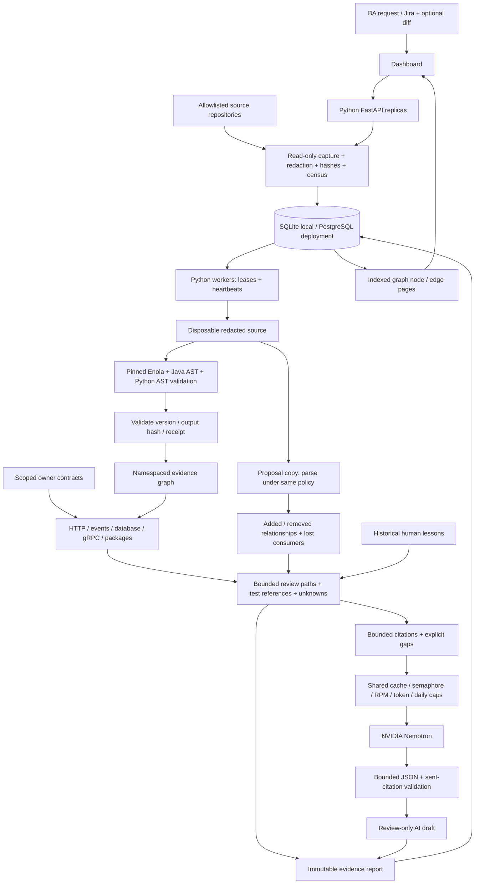

# Architecture and trust boundaries

Impact Studio is a Python application: FastAPI, SQLAlchemy, Pydantic, httpx, graph normalization, workers and review workflow. A pinned local Enola parser (Go implementation) adds language extraction. The native Java/Maven adapter remains for the financial fixture. The model does not author the authoritative graph.

## Request lifecycle

1. The BA selects a change repository and up to seven additional repositories. Roots and optional diff are validated. Captured hashes and file membership are rechecked to refuse source changes during ingestion. Each repository gets an immutable snapshot; the patch applies only to the focus repository, in memory.
2. Durable admission returns HTTP 202. Idempotency includes workspace snapshots, patch, intent, graph/parser policy and model configuration. Serialized admission caps the active queue at 100 jobs.
3. Workers claim with compare-and-update, renew every 15 seconds and recover expired work at most four times. Cancellation and owner/lease checks fence late result commits. Provider deferrals do not consume crash recovery attempts.
4. Content-addressed source graph caching includes content, raw hashes, repository identity, skipped census, parser binary identity and graph policy. Parser/version failure yields file evidence and explicit unknowns. Cancellation/ownership is checked again before new inference.
5. The parser receives a disposable, redacted snapshot and platform-owned configuration. Repository provider config, agent instructions and hooks are excluded. Providers, update checks, history and incremental state are disabled. No repository code, build or tests are invoked.
6. Version, fact count and fact-file SHA256 must match the receipt. An independent Python AST check exposes malformed syntax even when the parser reports zero parse errors.
7. Nodes are namespaced by repository. Static source edges require resolved parser target IDs; bare target names remain unresolved. Duplicate Java qualified identities withhold ambiguous edges. Maven dependencies are coarse build evidence.
8. Cross-repo contracts require deployment scope: HTTP method/origin/environment/route; broker/environment/channel for events; database/environment/table for storage. Missing or duplicate providers remain unknown. Parsed HTTP contradictions withhold declared joins.
9. Diff lines anchor source declarations; unsupported formats have conservative file anchors. Intent-only roots remain lexical hypotheses. Owner-declared associations widen review scope explicitly. BFS is bounded to 2,000 nodes / 12 hops and reports an untraversed frontier.
10. The proposal is parsed separately under the same policy. Edge identity compares source/target/kind, avoiding false deltas from changed line numbers. Lost cross-repo matches are review alerts, not observed runtime failures. Delta claims are withheld after extraction failure, syntax errors or incompatible receipts.
11. Greedy test selection uses actual static source references. A narrow Python TestClient adapter requires a literal request and explicitly imported app. Names alone never establish coverage. Selected tests are not executed by the job.
12. Bounded cited context, unresolved sites and graph deltas go to Nemotron. Model schema/citation validation rejects unsupported IDs. The model cannot edit, execute, publish, merge, deploy or clear the review gate.
13. One SQL transaction checks job ownership and commits report plus indexed node/edge rows. The UI pages graph nodes, exports evidence/Jira/BDD, checks all workspace snapshots for drift and records human planning lessons.

## Graph vocabulary and direction

| Relationship | Meaning | Resolution |
|---|---|---|
| Local parser edge | Resolved static call/type/import relationship | PARSER_RESOLVED; no compiler/runtime guarantee |
| Java/Maven rule | Native supported syntax/configuration rule | STATIC_RULE; build dependencies are coarse |
| File / Maven build scope | File contains declaration; changed module build includes its source | COARSE_FILE_SCOPE / COARSE_BUILD_SCOPE; no execution claim |
| Contract association | Owner associates source with interface | DECLARED; review the assumption |
| Cross-repo contract | Unique scoped provider → consumer join | DECLARED_MATCH; HTTP source corroboration recorded separately |
| Unresolved site | Missing target, unsupported feature or boundary | Unknown; never a proof of isolation |
| Historical lesson | Previous human planning review | Suggestion, not current dependency/test proof |

Source entities include files, classes, symbols, routes, storage, dependencies, tests and contracts. Change dependency edges point from dependency to consumer. Static execution/dispatch facts have a separate `execution_edges` view. The native banking adapter also records explicitly labelled downstream request-flow edges for data-value propagation. Reports combine supported directions into conservative review scope, without claiming every included component executes or fails.

Any bounded UTF-8 repository can be registered. Semantic depth depends on language/framework adapters. SQL/COBOL/custom formats can have declared external contracts while internal calls stay unknown. Consumers outside the loaded workspace and dynamic deployment bindings cannot be proven from one repository.

## System design controls

| Concern | Implemented mechanism |
|---|---|
| Persistence | SQL snapshots/jobs/events/source and inference caches/reviews/graph read model |
| Query cost | Indexed job/node/kind/source/target; pages ≤200 nodes; batched inserts |
| Worker concurrency | Separate processes; shared SQL claims, leases and owner-checked commit |
| Provider concurrency | One shared inference slot regardless of worker count |
| Backpressure | 100 jobs; 8 repos; 25 MB/10,000 captured files per repo; 30,000 traversed files; native parser 90s; bounded paths/context |
| Cost control | Default RPM6, estimated token units24,000/minute, daily100; application limits, not account entitlement |
| Failure isolation | Model errors preserve source results; extraction errors expose unknowns |
| Retry/circuit behavior | No blind POST retries; bounded 202 polling; shared Retry-After cooldown and three-failure breaker |
| Cache correctness | Source/parser/policy identity; model/prompt/provider fingerprint for inference |
| Audit/drift | Raw source hashes, citations, events; drift checked for every selected repository |
| Review memory | Completed reports accept human notes; notes do not change gate or execution status |

Local operation uses SQLite WAL. PostgreSQL/Docker Compose provides a one-time initializer, two API processes and scalable workers. Docker orchestration is untested here. SQL supports the bounded adjacency/read workload; a logical knowledge graph does not require a graph database. A later graph-engine adapter must preserve identity, provenance and uncertainty semantics.

The native parser is not an OS sandbox. Production extraction should run in containers with CPU/memory/filesystem/network limits. Copying/cleanup adds I/O beyond the native invocation timeout. Exactly-once external inference is not claimed after an ambiguous provider acceptance or worker crash.

## Verification and release authority

Independent authored Java experiment: 5 pass → producer-only 2 failures → coordinated reader fix 5 pass. Four HTTP processes verified value conservation and replay. Independent Python endpoint experiment: 3 pass → endpoint-only 1 failure → migrated expectation 3 pass. Both display source/patch hashes separately from analysis jobs. Go/TypeScript/SQL execution is not claimed.

Only REVIEW_REQUIRED and BLOCKED_BY_SOURCE_RULE gates exist. No graph, lesson or model approves a release. Defender Gherkin is a draft; Defender execution and Jira publication are not configured.

Institutional deployment still needs migrations, SSO/RBAC/tenant isolation, encrypted storage/retention, approved code egress, isolated extraction/test runners, runtime evidence adapters, metrics/tracing and a governed executed-evidence approval store. Zero defects and complete runtime discovery are not achievable guarantees from this prototype.
