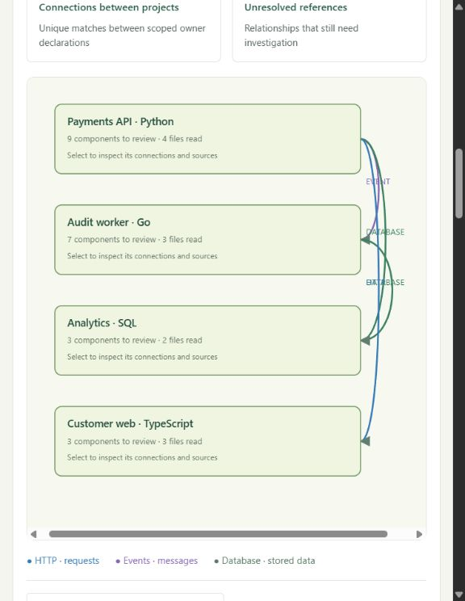
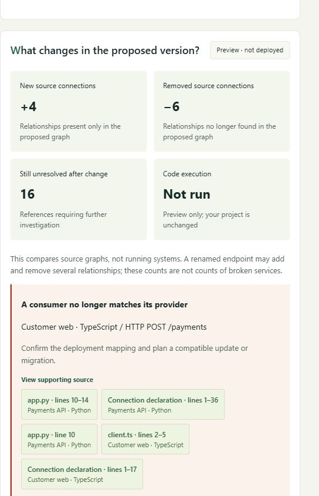
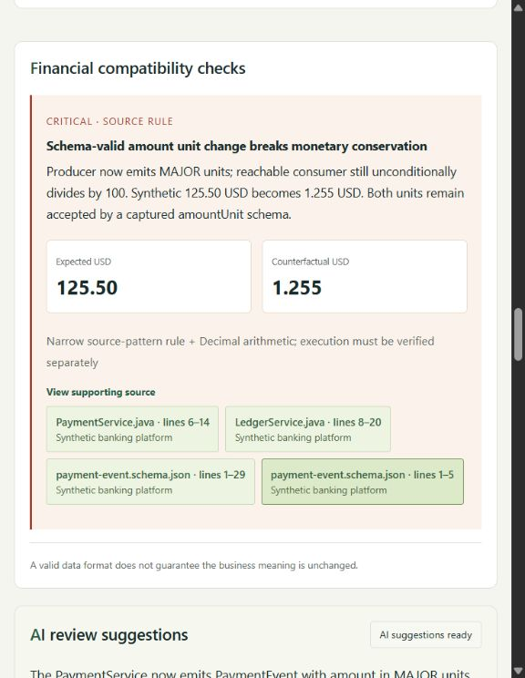
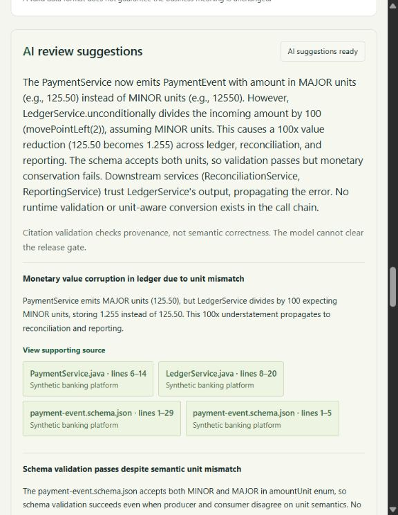
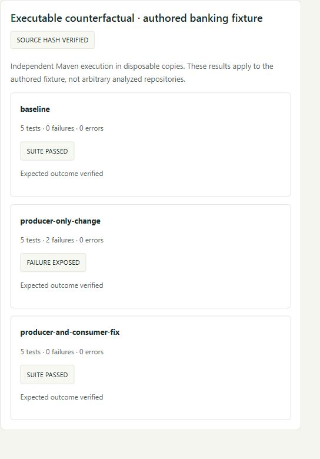

# Impact Studio — five-minute demo

**A change request becomes a source-backed map of downstream impact, a compatibility rehearsal and a focused testing plan.**

Opening line: “An endpoint can break another repository’s consumer. A valid payment event can corrupt a financial total. We show where to look, why it matters and what to test before making the change.”

## Before presenting

Start the app using the [README setup](README.md#run-locally), then open <http://127.0.0.1:8080/>. Choose **Try endpoint-change example** or **Try payment-value example**, then **Analyze change**. Configure a NVIDIA key for AI suggestions and allow inference time before presenting. Previously completed reports can be opened under **AI status & history** without a new AI request; a fresh checkout has no saved history.

These screenshots were captured on **9 October 2026** using synthetic repositories. `nvidia/nemotron-3-ultra-550b-a55b` returned the payment analysis in **57.05 seconds**, passing format and citation checks. The endpoint run received NVIDIA HTTP 503; source analysis remained available. These are historical results, not guarantees of current model availability or response time.

## 1. Follow impact across languages · 45 seconds

**Show:** Endpoint analysis → **System connections**.

**Say:** “Payments is Python, the web consumer is TypeScript, the audit worker is Go and reporting is SQL. The graph connects HTTP requests, events and database consumers across repository boundaries.”

Four scoped, owner-declared connections join the projects. Click a file reference to inspect the source. Extracted relationships, declarations and unresolved references remain distinguishable; SQL internals remain unknown.

## 2. Rehearse a change before applying it · 45 seconds

**Show:** **What changes in the proposed version?**

**Say:** “Renaming `/payments` to `/payments/v2` removes the web consumer’s declared provider match. We can see this before touching the repository.”

Original and proposed source graphs are compared without editing the project. Audit and reporting remain in review scope. Added and removed counts describe relationships, not broken services.

## 3. Find the financial error a schema misses · 60 seconds

**Show:** Payment analysis → **Impact summary** → **Financial compatibility checks**.

**Say:** “The producer switches to major units. The ledger still divides by 100. A valid event now turns **125.50 USD into 1.255 USD**, and that interpretation reaches reconciliation and reporting.”

A narrow source rule and decimal arithmetic expose the mismatch, linking the producer, consumer and schema. The decision remains **Fix required**. This is a fixture-specific monetary-conservation check.

## 4. Turn evidence into AI-assisted review · 60 seconds

**Show:** **AI review suggestions**, then **Tests & acceptance**.

**Say:** “Nemotron receives bounded source evidence and returns cited risk hypotheses, business questions and Given/When/Then proposals. The BA, developer and tester start from the same evidence.”

The live run produced **six risk hypotheses, six BA questions and six test proposals**. Show the ledger-conversion and end-to-end conservation scenarios alongside five selected existing Java tests. Export scenarios and the Jira brief; Defender execution is not connected here.

Citation checks establish provenance, not correctness; AI cannot clear the gate. An identical-context rerun reused the response: **provider requests stayed at 8; cache hits increased from 0 to 1**. Shared budgets and bounded calls control API use.

## 5. Close with executable evidence · 60 seconds

**Show:** Payment analysis → **Impact summary** → **Executable counterfactual**.

**Say:** “Here is an independent regression experiment: five tests pass at baseline, two fail after the producer-only change, and all five pass after the coordinated consumer fix.”

Stored Maven results match the current fixture and patch fingerprints. Execution used disposable copies, separately from the analysis job. The Python endpoint experiment records **3 pass → 1 failure → 3 pass**. These results apply to the authored fixtures.

Finish with **Check for source changes** and team exports. Unknown dependencies and missing test links stay visible. Reviewed lessons retain migration checks for related requests without approving release.

Closing line: “Cross-repository evidence, safe change rehearsal, financial semantic checks and AI-assisted test planning—all in one review workflow.”

Capture and verification details: [capture receipt](docs/demo/capture-receipt.json). Five focused screenshots; no credentials or environment files are included.
