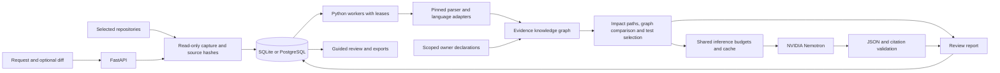

# Impact Studio

### AI change review, backed by source evidence

**Turn a change request into a map of affected systems, an explanation of the risk, and a focused testing plan.**

Changing a payment endpoint can take one line of code. Finding every consumer, coordinating its owner, protecting audit events and choosing the right regression tests can take several teams.

Impact Studio brings that investigation into one guided workspace. It captures the selected repositories, builds an evidence knowledge graph, compares proposed changes, and asks NVIDIA Nemotron for cited review suggestions. Every result can be inspected at its source. Unresolved relationships remain visible.

The tool is built in **Python**. The bundled **Maven / Spring Boot banking application is a separate system to analyze**, with real downstream services and authored regression tests.

## Two changes that make the value visible

| Change | What Impact Studio reveals | Independently verified sample outcome |
|---|---|---|
| Move `POST /payments` to `/payments/v2` | The TypeScript consumer loses its scoped HTTP contract match. Go audit and SQL reporting remain in review scope through event and database declarations. | Python fixture: **3 pass → 1 failure → 3 pass** after updating the consumer expectation. |
| Change a Java payment event from minor to major units | A downstream conversion still divides by 100. **125.50 USD becomes 1.255 USD**, despite a valid event format. A narrow source rule identifies the interpretation mismatch. | Maven fixture: **5 pass → 2 failures → 5 pass** after a coordinated consumer fix. |

These experiments use disposable copies of the authored fixtures. They are separate from an analysis job, which **selects tests but does not execute them**. The Java amount rule is deliberately specific; it does not claim to detect every financial defect.

## Features that change the review process

### 1. Rehearse a change before it reaches a deployment

Supply a unified diff and compare the baseline graph with the proposed graph. See which connections appear, disappear or become unresolved, and which captured consumers lose their provider match. The original repository stays unchanged.

**Useful when:** a small API or contract change crosses team boundaries. A lost match becomes a concrete compatibility review with source references, rather than a general warning to “check downstream systems.”

### 2. Follow dependencies across languages and repositories

The graph combines static parser facts, supported Java/Maven and Python analysis, and explicit owner declarations. It namespaces source entities by repository and joins HTTP, event, database, gRPC and package contracts within their declared deployment scope.

An HTTP join checks method, route, origin and environment. Event joins require broker identity; database joins require database identity. Missing or ambiguous providers remain unresolved. Where supported parsed HTTP routes contradict a provider declaration, the declared join is withheld.

**Useful when:** one business journey spans an API, web client, worker and reporting repository. Teams can distinguish a resolved source relationship, a declared connection and a conservative file association.

### 3. Catch a business meaning change that a valid format can conceal

The banking fixture demonstrates a change that preserves the event format while breaking monetary interpretation. The source rule uses decimal arithmetic to show the expected and counterfactual values, then links the result to the downstream conversion and relevant tests.

**Useful when:** technical compatibility alone is insufficient. Reviewers see the business consequence of the supported pattern, with an inspectable explanation.

### 4. Open the evidence behind a finding

Click a button such as **`app.py · lines 10–14`** to inspect the captured excerpt and its project. Technical details retain the internal evidence identifier, extraction basis and SHA256 source hash. Parser receipts record version and output identity. A workspace drift check detects changes since the report was captured.

**Useful when:** a reviewer needs to challenge a result, reproduce its basis or hand it to another team. AI advice cannot replace the evidence trail.

### 5. Produce a focused testing and ownership handoff

Supported source references connect affected components to existing test candidates. The report shows selected tests, components without direct test links, BA acceptance drafts and suggested work for each owner.

Download a **Jira review brief**, **Gherkin scenarios** or the **full evidence report**. The Jira brief includes contract alerts, source findings, AI availability and unresolved scope. Use approved scenarios in the organization's existing Defender / BDD process; direct Jira publication and Defender execution are not configured.

### 6. Make uncertainty part of the result

The coverage ledger shows files captured, files with extracted facts, skipped files and unresolved references. Unsupported formats retain file evidence and explicit gaps. Graph counts are explained as review scope, never as accuracy percentages or passed-test counts.

**Useful when:** a team must decide what still needs investigation. An unreached component is never presented as proof of safety.

### 7. Retain knowledge from human reviews

Save a reviewed planning lesson and retrieve related notes through intent and shared source components. A future reviewer can see why a similar change needed special attention. Lessons remain human planning guidance and cannot approve a release or certify test execution.

### 8. Use a constrained AI allowance responsibly

Workers share a database-backed inference slot, request budgets, validated cache, cooldown and circuit breaker. Context is bounded to relevant evidence. Identical validated contexts can reuse a response without another inference call.

Timeouts, provider outages and rejected replies leave the source report available. HTTP 202 responses use bounded, budgeted status checks without duplicating the inference POST. There are no blind automatic POST retries.

## A workflow for the whole team

**Describe → Review impact → Check sources → Plan tests**

1. **BA:** describe what should change and what must keep working. Select the changing project and relevant downstream projects.
2. **Developer:** optionally add the proposed diff, investigate compatibility alerts and inspect the connection map.
3. **Reviewer:** open supporting file references, check unresolved relationships and confirm deployment assumptions.
4. **Tester:** review existing test candidates and acceptance scenarios, add missing cases and run them in the normal test environment.
5. **Team:** check for source drift and attach the review brief and actual test results to Jira.

The interface includes ready-to-use examples, contextual guidance, a terminology guide and readable AI failure messages. Saved analyses open without submitting a new AI request.

## Architecture



| Layer | Technology and responsibility |
|---|---|
| Interface | HTML, CSS, JavaScript and SVG; guided review, graph exploration, source inspection and exports. |
| API | Python 3.12+, FastAPI, Uvicorn and Pydantic; validation, repository capture and asynchronous job admission. |
| Source extraction | Pinned Enola CLI 0.4.26, Tree-sitter Java, Python AST and Maven XML analysis. |
| Knowledge graph | Python normalization and scoped contract matching; persisted nodes and edges with indexed SQL queries. A separate graph database is not required for this bounded workload. |
| Persistence | SQLAlchemy; SQLite WAL for local use, PostgreSQL configuration for shared deployment. |
| Workers | Separate Python processes; idempotency, leases, heartbeats, cancellation and owner-checked commits. |
| AI | HTTPX adapter to NVIDIA; bounded context, shared admission, cache and structured response validation. |
| Verification fixtures | Python / TypeScript / Go / SQL example workspace and a separate Maven / Spring Boot / JUnit banking platform. |

### Scale and failure controls

Source analysis and inference have separate controls. Adding workers does not increase the single shared AI concurrency allowance. Defaults bound the queue to 100 active jobs, each analysis to 8 repositories, and traversal to 2,000 nodes / 12 hops. Graph queries page at most 200 nodes.

Source caches include repository, content, parser and policy identity. Inference caches include context, model and prompt identity. Transactions fence late worker commits; cancellation prevents a cancelled job from publishing its result. Parser failure exposes unknowns, while AI failure preserves source findings.

The PostgreSQL Compose configuration includes schema initialization, two API processes and scalable workers. **Docker/PostgreSQL orchestration has not been exercised in this workspace.** See [ARCHITECTURE.md](ARCHITECTURE.md) for the lifecycle, trust boundaries and production deployment requirements.

## Run locally

Install dependencies from a local checkout. Internet access is needed for initial installation; hosted AI additionally needs an available NVIDIA key and model. Private configuration, runtime data, caches and build output are excluded from Git.

Python 3.12 or later is required. Java 17+ and Maven are needed only for the Java fixture's build and execution.

### Windows PowerShell

Run these commands from the project root:

```powershell
python -m venv .venv
& ".\.venv\Scripts\python.exe" -m pip install -r requirements.txt
& ".\.venv\Scripts\python.exe" run.py --check
& ".\.venv\Scripts\python.exe" run.py
```

No PowerShell script execution-policy change is needed. The Python launcher starts the API and a hidden worker. **Ctrl+C stops both.** If port 8080 is occupied, use `run.py --port 8081`.

### macOS / Linux

```bash
python3 -m venv .venv
.venv/bin/python -m pip install -r requirements.txt
.venv/bin/python run.py --check
.venv/bin/python run.py
```

Open **http://127.0.0.1:8080**. Choose **Try endpoint-change example**, then **Analyze change**. SQLite is the default; no database username or password is required. With no AI key, the source workflow still works and the UI shows **AI not connected**.

### Connect NVIDIA when ready

Set backend environment variables before starting the launcher. Replace the placeholder locally; never paste your key into the browser or commit it.

```powershell
$env:NVIDIA_API_KEY = "YOUR_NVIDIA_KEY"
$env:NVIDIA_MODEL = "nvidia/nemotron-3-super-120b-a12b"
& ".\.venv\Scripts\python.exe" run.py
```

On macOS / Linux, use `export NVIDIA_API_KEY="YOUR_NVIDIA_KEY"` before starting the app. The model shown is the application's default and can be changed through `NVIDIA_MODEL`. Availability and free/trial allowance depend on the NVIDIA account; they are not guaranteed by this project.

| Setting | Default / purpose |
|---|---|
| `DATABASE_URL` | SQLite at `data/impact.db`; override for PostgreSQL. |
| `REPOSITORY_ROOTS` | Bundled `examples` folder; semicolon-separated approved roots for other projects. |
| `NVIDIA_RPM` / `NVIDIA_TPM` | 6 requests and 24,000 conservatively estimated token units per minute. |
| `NVIDIA_DAILY_CALLS` | 100 daily requests reserved by the application. |
| `NVIDIA_MAX_INPUT_CHARS` / `NVIDIA_MAX_OUTPUT_TOKENS` | 24,000 input characters / 2,500 output tokens. |
| `IMPACT_API_TOKEN` | Optional application authentication. Supply this token through **API connection**; it is separate from the NVIDIA key. |

These budgets are **application policies**, not NVIDIA entitlement figures. Existing process environment variables take priority over an optional, private local `.env` file. Restart the API and worker after changing configuration.

For Compose, create a private local `.env` containing `POSTGRES_PASSWORD` and `IMPACT_API_TOKEN`; optionally add `NVIDIA_API_KEY` and `NVIDIA_MODEL`. Use a strong URL-safe password for the supplied database URL. Then run `docker compose up --build -d`; add workers with `docker compose up -d --scale worker=2`. Keep that private file out of source control.

## Review your own repositories

Set `REPOSITORY_ROOTS`, restart, and select **+ Add project**. Register downstream source as additional projects, include them in the review, and describe the change. Add a matching diff for a more precise before-and-after comparison.

Bounded UTF-8 source capture accepts different repository layouts and formats. **Semantic depth depends on the language and framework adapters.** Consumers outside the selected workspace, runtime routing, reflection and undeclared deployment bindings can remain unknown.

Owner metadata and scoped interfaces use `.impact-contracts.json`. For example:

```json
{
  "version": 1,
  "service": "payment-api",
  "owner": "Payments engineering",
  "contracts": [{
    "protocol": "http", "role": "provides",
    "file": "app.py", "line": 10,
    "method": "POST", "resource": "/payments",
    "scope": "https://payments.internal", "environment": "uat"
  }]
}
```

The consumer declares `consumes` with the same deployment identity and its expected method/path. See the bundled [polyglot workspace](examples/polyglot-bank/README.md) for complete examples.

## Verification you can inspect

Automated checks cover backend behavior, presentation logic, JavaScript syntax and browser interactions. Provider tests use mock transports, including timeouts, unavailable accounts, rate limits, malformed output and unknown citations. See [VERIFICATION.json](VERIFICATION.json) for recorded results and [the demo](DEMO.md) for a separately captured live AI run.

```bash
python -m pytest -q
node --test tests/test_experience.cjs
python scripts/verify_polyglot.py
python scripts/verify_fixture.py
```

The last two commands independently execute the authored fixtures in disposable copies. The Java experiment requires Java and Maven; an existing Maven cache can be supplied with `--maven-repo=C:/path/to/repository`. Building the sample with `mvn package` also enables its four HTTP services; setup is in the [banking fixture README](examples/banking-platform/README.md).

[VERIFICATION.json](VERIFICATION.json) records validation scope and prior fixture experiments. [REFERENCE_REVIEW.md](REFERENCE_REVIEW.md) documents a bounded evaluation of five reference archives: **997 source files evaluated**, without executing their repository code. This is compatibility evidence, not a calibrated accuracy benchmark.

## Safety and scope

Analysis reads source and validates the proposed diff without editing repositories, running their code, merging or deploying. AI can produce review drafts only; it cannot clear the release gate. Schema and citation checks verify response structure and supplied references, not the correctness of every interpretation.

Captured evidence is sent to NVIDIA when hosted inference is configured. Use approved repositories. Secret-file exclusions and pattern redaction reduce exposure but do not constitute a complete data-loss-prevention system. Production use needs approved code egress, isolated extraction and test runners, SSO/RBAC, tenant isolation, retention, migrations and operational monitoring.

Impact Studio provides traceable evidence and explicit gaps. It does not promise zero defects, universal downstream discovery or automatic banking release approval.

## Repository layout

| Path | Purpose |
|---|---|
| `studio/` | API, extraction, knowledge graph, analysis, provider controls and guided UI. |
| `examples/` | Small polyglot and Maven banking source fixtures, contracts and proposed diffs. |
| `tests/` | Backend and presentation regression checks. |
| `scripts/` | Fixture generation and independent verification. |
| `docs/demo/` | Application screenshots and historical capture receipt. |
| [prompt.md](prompt.md) | Reproducible engineering brief and the runtime inference contract. |
| [DEMO.md](DEMO.md) | Guided walkthrough with application screenshots. |
| [ARCHITECTURE.md](ARCHITECTURE.md) | Detailed system design and boundaries. |
| [THIRD_PARTY_NOTICES.md](THIRD_PARTY_NOTICES.md) | Dependency and reference acknowledgements. |

The launcher creates `data/` for the local database and logs. Those files stay local; source, test fixtures and demo screenshots belong in the repository.
